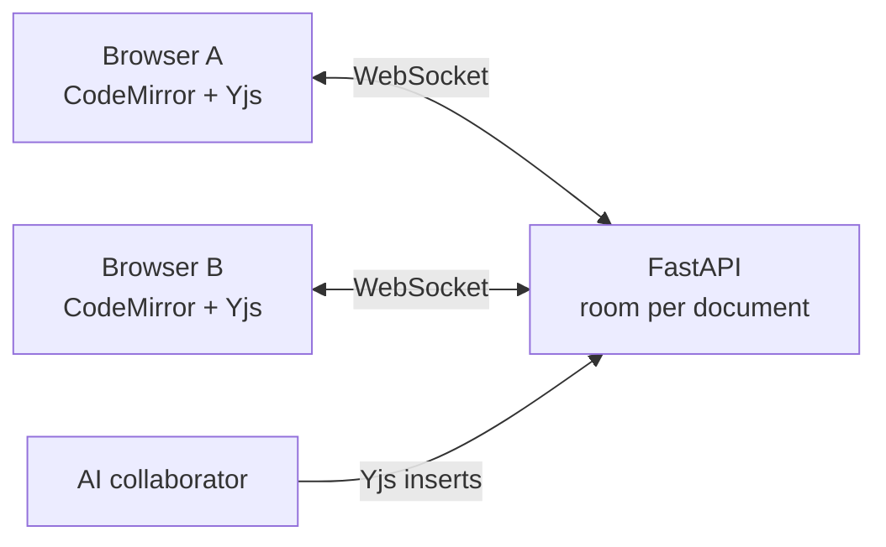

# dokuWriter

A multiplayer Markdown editor with real-time collaboration and an AI collaborator that types into the document alongside you.

Open a link and start writing. Everyone in the room edits the same document live and sees each other's cursors. An AI agent can join and stream text in as if it were another person typing.

There is no managed real-time backend. Conflict resolution runs on a CRDT ([Yjs](https://yjs.dev)), and the WebSocket rooms are served by a custom Python FastAPI server.



## Status

Phase 1 is in progress. The local editor is done; real-time sync is next. See the [roadmap](docs/roadmap.md).

## Quickstart

Requires [mise](https://mise.jdx.dev) (it pins the Node version via `mise.toml`).

```sh
mise install
cd frontend
npm install
npm run dev        # http://localhost:5173
```

## Repository layout

| Path | Contents |
|---|---|
| [`frontend/`](frontend/) | Vite + React + TypeScript app with the CodeMirror 6 editor |
| `backend/` | FastAPI WebSocket server (planned) |
| [`docs/architecture.md`](docs/architecture.md) | Components, data flow, document model, wire protocol |
| [`docs/roadmap.md`](docs/roadmap.md) | Phases and steps |
| [`docs/adr/`](docs/adr/) | Architecture decision records |
| [`CONTRIBUTING.md`](CONTRIBUTING.md) | Commit and dependency conventions |
