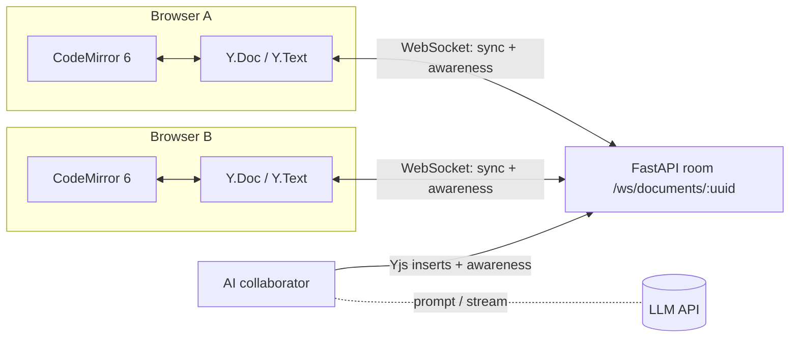

# Architecture

A map of the system: what the parts are, how data moves between them, and the constraints that shaped them. Decisions with their trade-offs are recorded in [`adr/`](adr/).

## Constraint: own the distributed state

There is no managed real-time backend (no Liveblocks, Convex, Pusher). Conflict resolution runs on Yjs (a CRDT), and a custom Python FastAPI server relays and owns the WebSocket rooms. The point of the project is this layer.

## Components

| Component | Stack | Status |
|---|---|---|
| Frontend | Vite, React, TypeScript, Oxlint, CodeMirror 6 (`@codemirror/*`, `@lezer/highlight`) | editor done |
| Sync | Yjs, `y-websocket`, `y-codemirror.next` | planned |
| Backend | Python, FastAPI, Uvicorn, WebSockets, `pycrdt`. Dev tools: `pytest`, `httpx` (test client), `ruff` | in progress |
| AI collaborator | Backend-side Yjs client fed by a streaming LLM | planned |
| Infrastructure | Docker Compose (local), Vercel (frontend), Render/Railway (backend container) | planned |
| Persistence / auth (Phase 2) | Supabase (PostgreSQL, Google OAuth) | planned |

## Document model

The document **is** Markdown text, stored as a single `Y.Text`. The editor is CodeMirror 6 configured as a writing editor, not a code editor: no gutters, prose typography, and dimmed syntax marks. ([ADR 0001](adr/0001-codemirror-string-document-model.md))

Rendering is a **view concern**. Hiding Markdown syntax (Obsidian-style live preview) uses CodeMirror decorations derived from the syntax tree and the local cursor, so it never touches the shared document. Each client decorates independently.

## Wire protocol

One WebSocket per client per room (`/ws/documents/:uuid`) carries two kinds of binary Yjs message:

1. **Sync**: document updates. These are CRDT operations that every client merges, and they converge regardless of arrival order.
2. **Awareness**: ephemeral presence per client (cursor, selection, name, color). It is never persisted, and the server must clear a client's presence when it disconnects.

The server keeps a Y.Doc per room, applies every update to it, and relays both kinds to every other client in the same room. Late joiners sync against the server's doc. Rooms are isolated by UUID. ([ADR 0003](adr/0003-server-side-ydoc-with-pycrdt.md))

## Presence and cursors

Remote cursors are Google Docs-style text carets and selections, not Figma-style mouse pointers. Positions are Yjs relative positions anchored to document content, so they stay correct across devices, screen sizes and concurrent edits. ([ADR 0002](adr/0002-text-cursors-via-awareness.md))

## AI collaborator

The AI is "just another client":

- It joins the room with its own awareness state (name and color), so its cursor renders like a human's.
- It streams LLM output as Yjs **insertions only**. It never deletes or overwrites existing text.
